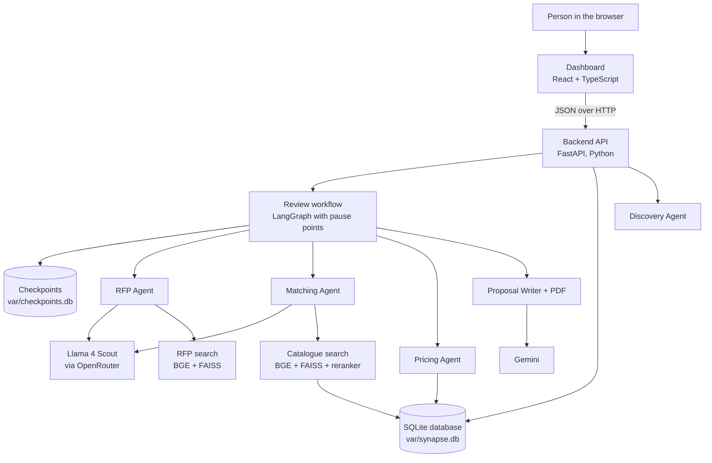
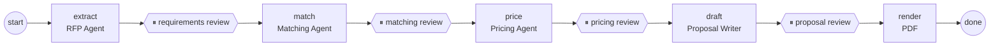
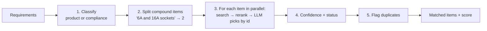

# SYNAPSE: the complete project guide

Everything about the project in one place: what it does, what existed before,
what we built, how every part works and why it was built that way. Use it to
learn the system, to explain it to others, and as source material for reports
and slides. Each section starts with a plain-language summary and then gives
the technical detail.

**Team:** Shivam, Lakshay, Vidipt, Khushi, BML Munjal University (Project-III/IV)

---

## Contents

1. [The project in one minute](#1-the-project-in-one-minute)
2. [Before and after: what we started with and what we changed](#2-before-and-after)
3. [The big picture (architecture)](#3-the-big-picture)
4. [The journey of one RFP, step by step](#4-the-journey-of-one-rfp)
5. [The agents, one by one](#5-the-agents-one-by-one)
6. [The AI models and methods, explained](#6-the-ai-models-and-methods)
7. [Human-in-the-loop: pausing, saving and resuming](#7-human-in-the-loop)
8. [Data and databases](#8-data-and-databases)
9. [The backend (API)](#9-the-backend-api)
10. [The frontend (dashboard)](#10-the-frontend-dashboard)
11. [Security and safety decisions](#11-security-and-safety-decisions)
12. [Testing and what live runs taught us](#12-testing-and-what-live-runs-taught-us)
13. [Technology stack, and why each was chosen](#13-technology-stack)
14. [Folder and file map](#14-folder-and-file-map)
15. [Numbers worth quoting](#15-numbers-worth-quoting)
16. [Limitations, honest answers and future work](#16-limitations-and-future-work)
17. [Glossary](#17-glossary)
18. [Running it and working on it](#18-running-it-and-working-on-it)
19. [Suggested slide deck and report outline](#19-suggested-slide-deck-and-report-outline)

---

## 1. The project in one minute

**The problem.** Companies that sell electrical products win business by
answering tenders (an **RFP**, Request for Proposal). A buyer such as a
hospital or a school board publishes a document: "we need 300 16A switches,
120 sockets, these certifications, delivery in 30 days". A sales team then
reads a long PDF, finds every item in their own catalogue, works out prices
with margins, discounts and GST, and writes a formal proposal. It's slow,
repetitive and error-prone, and deadlines are tight.

**What SYNAPSE does.** It's a web dashboard, running on your own laptop,
where a team of **AI agents** does the heavy lifting and **a person approves
every step**:

1. **Find** tenders (generated sample tenders) or **upload** a real RFP PDF.
2. The **RFP Agent** reads the whole document and lists every requirement, with quantities and importance.
3. The **Matching Agent** finds the right product in the catalogue (353 Havells switches, sockets, plates, MCBs, boxes) for each requirement, says how confident it is, and admits when something isn't in the catalogue.
4. The **Pricing Agent** calculates the quote with **fixed business rules** (margin, volume discounts, 18% GST, freight, advance-payment discount). **No AI is involved in any money calculation.**
5. The **Proposal Writer** (Gemini) drafts the proposal text; a person edits it; the system produces a professional **PDF**.
6. A **dashboard** tracks deadlines, reminders and won/lost results.

After each step the work **pauses** for review: you can edit, reject, change a
product or adjust prices, and nothing moves on without approval. This is
called **human-in-the-loop**.

**The one-sentence pitch:** *AI does the reading, searching and writing; fixed
rules do the money; a person makes every decision.*

---

## 2. Before and after

### What existed before (Project-III, the `main` branch)

A **command-line prototype** (about 2,700 lines of Python). You typed a
question in a terminal and got a text answer.

```
python master_agent.py "Generate the full vendor proposal PDF"
```

- A **router** (an LLM call) sorted each question into one of six routes: rfp, bu, match, price, full, report.
- **RFP agent:** searched the one sample PDF for the 5 text chunks closest to "requirements eligibility deliverables…" and asked the LLM to list requirements, so only part of the document was read.
- **BU agent:** answered questions about the catalogue using retrieval (RAG) over three indexes.
- **Matching agent:** for each requirement, asked the LLM "can we fulfil this? YES or NO". It produced a percentage score but **did not say which product** matched.
- **Pricing agent:** used LLM calls and regular expressions to **read prices out of retrieved text**, then applied margin, volume discount and GST.
- **Report agent:** Gemini wrote the whole proposal, including the numbers, and reportlab turned it into a PDF. The vendor was hardcoded as "Havells India Ltd." and the buyer as "ABC Infrastructure".
- The LLM started on Groq and later moved to OpenRouter (Llama 4 Scout).

### Problems we found when reviewing it

| # | Problem | Why it mattered |
|---|---------|-----------------|
| 1 | No user interface, CLI only | Not usable by a sales team; nothing to demo visually |
| 2 | No review points; one long run from start to finish | A wrong requirement or product silently flowed into the final price |
| 3 | Matching said YES/NO, not *which* product | Pricing then had to search again and could pick a different product |
| 4 | Prices were read from text by the LLM/regex | A misread price is a wrong quote; prices must be exact |
| 5 | Only 5 chunks of the RFP were read | Requirements in the rest of the document were missed |
| 6 | JSON from the LLM parsed with regex, no validation | Random failures when the model added extra text |
| 7 | Embeddings rebuilt on every run, models reloaded each time | Slow start (minutes) |
| 8 | Global single "tool" objects tied to one hardcoded PDF | Couldn't work on a different RFP |
| 9 | No database; data in loose files; no stock information | Nothing persisted between runs |
| 10 | Unpinned dependencies, no `.env` handling, README out of date (Groq, wrong discount tiers) | Hard for teammates to set up |
| 11 | Agents printed to the console; Windows-only PDF opening | Crashed on Windows when output was redirected (₹ sign); can't run in a server |
| 12 | Discovery (GeM scraper) was a separate Streamlit app in another folder | Not part of the system |

The Project-III report also contains some numbers that don't match the code
and catalogue (for example, Table 5's pricing arithmetic is wrong in 3 of 5
rows, and it says RJ-45 and TV sockets aren't in the catalogue when they are).
Don't reuse those tables; use the numbers in [section 15](#15-numbers-worth-quoting).

### What we built (v2)

| Area | Before | Now |
|------|--------|-----|
| Interface | Terminal | Web dashboard (React) with login, 10+ screens |
| Flow | One run, no stops | Four review checkpoints; pause, leave, resume later |
| RFP reading | 5 nearest chunks | Whole document, in parallel windows |
| Matching | YES/NO per requirement | A specific product (id, SAP code, price), confidence, alternatives, gaps, duplicates |
| Pricing | LLM/regex reads prices from text | Prices from the database; pure code; reviewer can change margin, quantities, freight, advance payment |
| Proposal | AI writes everything incl. numbers | AI writes text only; numbers copied from approved pricing; section editor with live PDF preview |
| Data | Files | SQLite database (catalogue, stock, users, RFPs, projects) + saved workflow checkpoints |
| Discovery | Separate Streamlit scraper | Discovery Agent with swappable sources (sample tenders, upload, GeM adapter switched off) |
| Reliability | Regex JSON | Validated JSON (pydantic) with automatic retry |
| Speed | Rebuild embeddings each run | Disk cache + models loaded once (start in ~15–30 s) |
| Tests | A few unit tests | 141 offline tests + recorded live runs |
| Setup | Many manual commands | Double-click `start.bat` |

About 19,800 lines were added across 152 files.

---

## 3. The big picture

### Layers



**In words:**

- **The dashboard** is what you see. It only shows things and sends your decisions to the backend.
- **The backend** checks who you are, stores RFPs and projects, and runs the agents in the background.
- **The workflow** is the chain of agents with stops between them. Its progress is saved, so a project survives closing the browser or restarting the laptop.
- **The agents** do the work. Two of them use cloud LLMs; **search runs locally** on your laptop; **pricing uses only the database and code.**

### The workflow graph



The ⏸ boxes are where the system **stops and waits for a person**.

---

## 4. The journey of one RFP

What happens, screen by screen, and what the system does underneath.

### Step 0: Log in
You create an account (name, email, password). The password is never stored,
only a scrypt "hash" of it ([section 11](#11-security-and-safety-decisions)).
A login cookie keeps you signed in (12 hours, or 30 days with "Remember me").

### Step 1: Get an RFP (New Session)
Two tabs:

- **Find RFPs.** Enter keywords ("modular switches", "sockets", "cable"), a location, dates and a budget. The **Discovery Agent** generates realistic sample tenders that fit the search. Each one has a fictional buyer, deadline, budget and quantities, and every page is stamped "SAMPLE RFP, fictitious". Keywords the catalogue can't supply (like "cable") become line items we *can't* quote, so the matching step shows real gaps.
- **Upload a PDF.** Your own RFP. The system reads the text (PyMuPDF), rejects scanned images without text, and fills in buyer, deadline, location, category and budget: GeM documents by fixed rules, others with one LLM call.

Every RFP gets a fingerprint (SHA-256 of the file), so uploading the same file twice doesn't create duplicates.

### Step 2: Pick one RFP
The RFPs page lists them with badges (Sample, Closing soon). You choose **one**
and start a **project**: one RFP worked through the review steps.

### Step 3: Requirements (RFP Agent → ⏸ review)
The RFP Agent reads the **whole** PDF and returns a list like:

| ID | Requirement | Qty | Criticality |
|----|-------------|-----|-------------|
| R1 | 16A 2-way switch, white | 300 | mandatory |
| R2 | 6A/10A bell push switch | 40 | high |
| R7 | Provide ISI/BIS certification | | mandatory |

You can edit text and quantities, remove items or add missing ones, then
**Continue**. Every change is recorded in a review log with your name and the time.

### Step 4: Product matching (Matching Agent → ⏸ review)
For each requirement the agent finds a catalogue product and shows:

- the product, its SAP code, price, a **match score** and a **confidence** (high / medium / low);
- **alternatives**, if you prefer another product;
- **demo stock**: on hand, monthly capacity, lead time (clearly labelled as synthetic);
- **gaps**: "nothing similar in our catalogue";
- **duplicates**: two lines that resolve to the same product are flagged so they're not quoted twice;
- **compliance items** (certifications, GST registration) in a separate list, to mark Met / Not met.

You accept, reject or **Change Product** (search the catalogue yourself).
"Accept all" accepts everything except flagged duplicates.

### Step 5: Pricing (Pricing Agent → ⏸ review)
The quote is calculated from the **database prices**. You can:

- move the **margin** slider (0–60%);
- change any **quantity** (marked "set by reviewer");
- tick **advance payment** (2% discount) and add **freight**;
- download the quote as **CSV**.

The preview updates instantly and saves nothing until you continue.
See [the pricing agent](#53-pricing-agent) for the exact formula.

### Step 6: Proposal (Proposal Writer → ⏸ review)
Gemini drafts the text sections. The editor shows each section (tagged "AI
Generated" or "Edited") with a **live PDF preview**. You can edit any section,
**Regenerate** one with an instruction ("make it shorter"), or **Save draft**
and come back later. If anyone types a ₹ amount into the text, a warning appears.

### Step 7: Final PDF (render)
**Complete Generation** produces the PDF: cover details (prepared by / for,
reference, validity), the sections, the pricing table with GST, totals, the
items not quoted, and a signature block.

### Step 8: Track the result
In **Completed / History**, set Submitted / Won / Lost. The **dashboard**
updates: win rate, a six-month "Generated vs Won" chart, reminders and the
deadline calendar.

---

## 5. The agents, one by one

An **agent** here is a step with one job: it takes the shared project data
(`AgentState`), does its work (sometimes with an AI model), and adds its
results. They're joined into a graph with **LangGraph**.

### 5.1 Discovery Agent (`discovery/`)

**Job:** bring RFPs into the system.

**Design:** one common interface with interchangeable **sources**, so a new
source can be added without changing anything else:

| Source | Status | How it works |
|--------|--------|--------------|
| `SampleSource` (sample tenders) | **On** (default) | Turns keywords into product themes (switches, plates, sockets, regulators, MCBs, boxes), picks real catalogue products, adds off-catalogue items for gap keywords, invents a fictional buyer, and renders a PDF with reportlab. **Deterministic**: the same search gives byte-identical PDFs. |
| Upload | **On** | `metadata.extract_metadata()`: GeM-format documents are read by fixed rules; other documents use one LLM call (temperature 0) to pull title, buyer, deadline, location, category and budget. Never crashes; missing fields stay empty. |
| `GemSource` (live GeM portal) | **Off** | Our teammate's original Selenium scraper, ported behind the same interface. It refuses to run unless `DISCOVERY_GEM_ENABLED=true`, because the portal's terms may not allow scraping. It has **never been run against the live site**. Its text parser was tested on 32 tenders scraped earlier. |

**Why generated samples?** We have only one real sample RFP. Generated tenders
give unlimited, varied, realistic test inputs with known answers: we know
which items are in the catalogue and which aren't. They're always marked as
fictitious, so nobody mistakes them for real tenders.

### 5.2 RFP Agent (`rfp_agent.py`, `rfp_rag.py`)

**Job:** turn the PDF into a clean list of requirements.

**How:**

1. **Read** the text with PyMuPDF and split it into sections and chunks of up to 800 characters.
2. **Extract** requirements: the text is cut into **windows of 12,000 characters**, and each window goes to the LLM **in parallel** (up to 4 at once). This covers the **whole document**, not just a few search hits.
3. The LLM returns JSON: requirement text, quantity, criticality. The prompt defines the criticality levels and says "skip summary lines if a detailed list exists" (otherwise the same items were listed twice).
4. Results are **validated** against a schema; failures are retried once; a window that still fails becomes a **warning** instead of crashing.
5. Duplicates across windows are removed; IDs `R1, R2…` are assigned; weights come from criticality: **mandatory 4, high 3, medium 2, low 1**.
6. It also writes a short **summary** of the RFP. For short RFPs it reads all chunks; for long ones it uses retrieval (the 3 nearest chunks).

**Retrieval for the summary** uses BGE embeddings + FAISS (see [section 6](#6-the-ai-models-and-methods)). Each RFP's index is cached by file fingerprint (up to 8 RFPs in memory).

### 5.3 Matching Agent (`matching_agent.py`, `product_matcher.py`)

**Job:** for every requirement, name the exact catalogue product, or admit there isn't one.



1. **Classify** (1 LLM call, temperature 0): is each requirement a **product** to supply, or a **compliance** statement (certificates, GST, experience)? Specification sentences such as "switches shall conform to IS 3854" count as compliance. Compliance items are never auto-judged; a person marks them Met or Not met.
2. **Split compound requirements** (1 LLM call): "6A and 16A sockets in white and grey" becomes separate items (R3.1, R3.2…). Learned rules: expand module sizes and listed colours, but keep "6A/10A bell push" or "6–16A socket" as **one** item, because that's one product.
3. **Find candidates** for each item, **locally, without an LLM**:
   - *Embedding search*: turn the item text into a vector and fetch the 25 nearest catalogue products from FAISS.
   - *Rerank*: a **cross-encoder** (bge-reranker-base) reads the item and each product **together** and scores 0–1. Keep the top 5 scoring at least 0.05.
4. **Pick** (1 LLM call per item, temperature 0, 4 in parallel): the LLM sees the item and the 5 candidates and answers with **one candidate id, or null**. An id that isn't in the list is **rejected**, so the AI **cannot invent a product**. If several are equally good, it picks the first (highest reranker score).
5. **Confidence and status** from the reranker score:

   | Score | Confidence | Status |
   |-------|------------|--------|
   | ≥ 0.90 | high | matched |
   | 0.50–0.90 | medium | needs review |
   | < 0.50 | low | needs review |
   | no candidate ≥ 0.05, or LLM says null | — | **gap** |

   Thresholds were **calibrated on real data**: real matches score 0.55–0.99, unrelated products about 0.00.
6. **Duplicates:** if two items resolve to the same product, the highest-scoring one keeps it and the others are flagged `duplicate_of` for review.
7. **Fulfilment score** = weighted share of product items that were matched, using the criticality weights.

**Abbreviation expansion.** The catalogue says things like "Switch with Ind." while RFPs say "with indicator". The reranker scored that pair 0.03 (no match). We now add an "Also described as" line to each product's search text with abbreviations expanded (Ind.→Indicator, Reg.→Regulator, SP/DP→Single/Double Pole, MCB→Miniature Circuit Breaker), and the score became 0.99.

### 5.4 Pricing Agent (`pricing_agent.py`, `PricingRules` in `settings.py`)

**Job:** calculate the quote. **It makes no AI calls at all.**

It takes each approved item's `product_id`, looks up the **price in the
database**, picks the quantity, and applies the rules.

**Quantity source** (always shown in the UI): `reviewer` (you changed it) → `rfp` (stated in the RFP) → `requirement` / `query` → `default` (100, flagged so you check it).

**Per line:**

```
selling price   = catalogue price × (1 + margin%)
discounted      = selling price × (1 − volume discount%)
GST per unit    = discounted × 18%
final unit      = discounted + GST
line total      = final unit × quantity
```

**Volume discount tiers** (per line quantity):

| Quantity | Discount |
|----------|----------|
| 1–199 | 0% |
| 200–499 | 5% |
| 500–999 | 8% |
| 1000+ | 12% |

**Whole quote:**

- subtotal (excl. GST), GST total, and margin value (selling price minus catalogue cost);
- **advance payment** ticked: 2% discount on goods value (with matching GST reduction);
- **freight**: added, with GST;
- **grand total** = lines total − advance discount (incl. GST) + freight (incl. GST).

Margin is clamped to 0–60%. All amounts are rounded to 2 decimals at each step.

**Worked example** (illustrative numbers): catalogue price ₹100, margin 20%, quantity 300.

| Step | Value |
|------|-------|
| Selling price | 100 × 1.20 = ₹120.00 |
| Volume discount (300 → 5%) | 120 × 0.95 = ₹114.00 |
| GST 18% | ₹20.52 |
| Final per unit | ₹134.52 |
| Line total (×300) | ₹40,356.00 |

The tests check exact values like these ("golden values"); for example, the
real 16A 2-way switch at quantity 300 must come out at exactly ₹256.93 per unit.

**Why no AI here?** Prices must be exact, repeatable and auditable. LLMs make
arithmetic mistakes and can "hallucinate" numbers. The AI's only influence on
price is **which product** was chosen, and a person approves that.

`reprice_with_margin()` re-runs only the arithmetic, which is why the margin
slider preview is instant.

### 5.5 Proposal Writer and PDF (`proposal_writer.py`, `proposal_pdf.py`, `company_profile.py`)

**Job:** write the proposal and turn it into a PDF.

**Sections:**

| Section | Written by |
|---------|-----------|
| Company Information | Code (from the Settings page) |
| Executive Summary | AI |
| Understanding of Requirements | AI |
| Product Offering | AI |
| Pricing Schedule | Code (intro text) + the pricing table |
| Delivery & Logistics | AI |
| Warranty & After-Sales Support | AI |
| Eligibility & Compliance | AI |
| Terms & Conditions | AI |

**Model:** Gemini (`gemini-3.1-flash-lite-preview`) when a Gemini key is
set, otherwise Llama 4 Scout. It returns validated JSON (one entry per section).

**Rules given to the AI, and enforced:**

- **Never write amounts.** All numbers in the PDF come from the approved pricing. `amount_warnings()` scans the text for ₹ / Rs / INR / lakh / crore and warns the reviewer.
- **Claim compliance only for items a reviewer marked "Met"**; otherwise say documents will be submitted separately.

**The PDF** (reportlab) is fully **deterministic**: same inputs, same PDF.
The text is escaped so characters like "&" or "<" can't break it. The PDF font
has no ₹ glyph, so amounts print as "Rs." with Indian digit grouping
(10,10,763.50). "Prepared by" comes from **Settings** (a placeholder demo
company until you fill it in); "Prepared for" comes from the RFP's buyer.

### 5.6 The original Q&A agents (still there)

`master_agent.py` keeps the Project-III question-answering graph for the
command line: a **router** (LLM, temperature 0) picks a route, and agents
answer. The **BU Agent** (`bu_agent.py`) answers catalogue questions using
**three indexes**:

- small text chunks (256 lines of the catalogue text);
- large text chunks (105);
- one entry per product (353);

all reranked by the cross-encoder. The new workflow reuses these agents' code
but not the router.

---

## 6. The AI models and methods

### Models used

| Model | Type | Where it runs | Used for |
|-------|------|---------------|----------|
| **Llama 4 Scout** (`meta-llama/llama-4-scout`) | Large language model | Cloud, via OpenRouter | Requirement extraction, classification, splitting, product pick, upload metadata, Q&A |
| **Gemini** (`gemini-3.1-flash-lite-preview`) | Large language model | Cloud, Google | Proposal text |
| **BGE small** (`BAAI/bge-small-en-v1.5`, `bge-small-en`) | Embedding model | **Locally on the laptop** | Turning text into vectors for search |
| **BGE reranker** (`BAAI/bge-reranker-base`) | Cross-encoder | **Locally** | Scoring how well a product matches an item (0–1) |

The local models are downloaded once (~200 MB) and loaded **once per server
start**, shared between all requests (`models.py`).

### Key methods, plainly explained

**LLM (Large Language Model).** A model that reads and writes text. We use it
to *understand* messy documents and to *write*, never to *calculate* or to
*invent catalogue data*.

**Embeddings.** A way to turn a sentence into a list of numbers (a vector), so
that sentences with similar meaning end up close together. "16 amp two way
switch" and "16A 2-Way Switch" become nearby vectors even though the words
differ.

**FAISS.** A library from Meta that very quickly finds the nearest vectors
among thousands. It's our "search engine by meaning".

**RAG (Retrieval-Augmented Generation).** Instead of trusting the LLM's
memory, we **retrieve** the relevant text (RFP chunks or catalogue products)
and give it to the LLM with the question. The LLM answers from that
evidence. This reduces made-up answers.

**Cross-encoder reranking.** Embedding search is fast but rough: it compares
two separately made vectors. A cross-encoder reads the query and the candidate
**together** and judges the match far more accurately, but it's slower. So we
use embeddings to get 25 candidates, then the cross-encoder to rank them. This
"retrieve then rerank" pattern is standard in modern search.

**Structured output with validation.** We ask the LLM for JSON, then:

1. extract the JSON from the reply;
2. **validate** it against a pydantic schema (correct fields and types);
3. if it's invalid, **retry once** with the error;
4. if it still fails, raise a clear error, which the UI shows with a **Retry** button.

This replaced fragile regular-expression parsing (`llm_json.py`).

**Temperature.** Controls randomness. **0** for decisions (routing,
classifying, splitting, picking products, metadata) so the same input gives the
same answer; **0.3** for extraction and writing; **0.4** for catalogue Q&A.

**Constrained choice.** The LLM picks a product **by id from a given list**.
It can't name a product that doesn't exist, and its answer is checked in code.

**Parallelism.** Independent LLM calls (RFP windows, product picks) run 4 at
a time in a thread pool, which is much faster than one by one.

**Prompt lessons from live runs** (good presentation material):

- Llama 4 Scout sometimes "thinks out loud" in Markdown and runs out of space before writing the JSON. Adding a strict "respond with JSON only" instruction to every prompt took failures from **28 of 40 picks to 0**.
- OpenRouter's built-in "JSON mode" returns an error for this model, so we validate ourselves instead.

---

## 7. Human-in-the-loop

**The idea:** the AI proposes and a person decides. After each agent, the
project **stops** until someone reviews it.

**How it works (LangGraph):**

- Each review step calls `interrupt()`. LangGraph **saves the entire project state** to a checkpoint database (SQLite, `var/checkpoints.db`) and stops.
- When you click Continue, the API sends your **decision** (a validated object: edits, accepted/rejected items, margin, quantities, section edits). The workflow **resumes exactly where it stopped**, applies your decision and runs the next agent.
- **Decisions are checked before resuming.** The decision is first applied to a copy as a dry run; if it's invalid (for example an unknown item ID), you get an error and the project doesn't move.
- **Resilience:** because state is saved, you can close the browser, restart the server or the laptop, and continue later. If an AI step fails (network, credit), the project shows the error and **Retry** re-runs only that step.
- **Audit trail:** every decision goes into a `review_log` with the reviewer's name and time.

Technical notes for developers:

- Review nodes must have no side effects before `interrupt()`, because they re-run on resume.
- Saving a proposal draft while paused uses `update_state(as_node="draft")` followed by `invoke(None)` to re-enter the pause; a plain `update_state` would lose the pending pause.
- The project ID is the checkpoint's `thread_id`.

---

## 8. Data and databases

### Where data lives

Everything runtime is in the **`var/`** folder, which is never committed:

| File / folder | Contents |
|---------------|----------|
| `var/synapse.db` | Main SQLite database |
| `var/checkpoints.db` | Saved workflow states (LangGraph) |
| `var/uploads/`, `var/discovery/` | RFP PDFs (uploaded / generated) |
| `var/proposals/` | Generated proposal PDFs |
| `var/cache/embeddings/` | Cached embedding vectors |

### Why SQLite
A single file, no server to install, built into Python, and enough for one
team on one laptop. We access it through **SQLAlchemy** (Python classes
mapped to tables), so moving to PostgreSQL later would mostly be a
configuration change.

### Tables (`db.py`)

| Table | What it holds |
|-------|---------------|
| `products` | The 353 catalogue products: id, range, variant, name, SAP code, HSN code, packing, **price as a number** |
| `stock` | Synthetic demo stock per product (on hand, monthly capacity, lead time, `is_demo = true`) |
| `meta` | Bookkeeping, e.g. the fingerprint of the catalogue file last loaded |
| `app_settings` | Small JSON settings, e.g. the company profile |
| `users` | Accounts (email, name, **password hash**) |
| `sessions` | Logins (only a **hash** of the cookie token, expiry) |
| `rfps` | Each RFP: title, source, file path, fingerprint, pages, buyer, deadline, location, category, budget |
| `projects` | One per RFP worked on: stage, running/progress, error, grand total, fulfilment score, proposal path, outcome, completed/outcome dates |

The **full working state** of a project (requirements, matches, prices,
sections) lives in the checkpoint database. The `projects` table keeps
summary columns so lists and the dashboard load fast.

### Database techniques worth mentioning

- **Single source of truth:** the catalogue JSON is loaded into the `products` table, and everything else (search indexes, pricing) is built from that table. The search indexes are a **cache** and can always be rebuilt.
- **Automatic reload:** the system stores a SHA-256 fingerprint of the catalogue file; if the file changes, it reloads automatically.
- **Price parsing:** catalogue prices such as "54/-" are converted to numbers once, at load time.
- **Stable product IDs:** SAP codes are **not unique** in the catalogue (3 duplicates), so each product's ID is a hash of range, variant and name.
- **Deterministic demo stock:** stock is generated with a fixed random seed (2026), so it's the same on every laptop; about 15% of products are deliberately low on stock so the UI shows warnings.
- **Deduplication by content fingerprint:** RFP files are identified by SHA-256, so the same file is never stored twice.
- **Light migration:** when we add a new optional column, `_add_missing_columns()` adds it to existing databases at start-up (and back-fills it where sensible), so nobody has to delete their database.
- **Embedding cache:** vectors are saved to disk, keyed by model + exact text, so restarts don't recompute them.
- **Checkpointing:** LangGraph's SqliteSaver stores each project's state after every step.

---

## 9. The backend (API)

**FastAPI** (Python) serves both the API and the built dashboard at
`http://127.0.0.1:8000`. Interactive API docs are at `/docs`.

| Area | Main endpoints |
|------|----------------|
| Accounts | register, login, logout, me |
| RFPs | upload, list/search, get, view document |
| Discovery | list sources, search (generates and registers RFPs) |
| Projects | start, list, get (with all screen data), review (submit a decision), retry |
| Pricing | preview (instant, saves nothing), rules, quote.csv |
| Proposal | preview PDF, regenerate a section, save draft, final PDF, set outcome |
| Catalogue | product search (for Change Product) |
| Dashboard | KPIs, reminders, deadlines, monthly activity, pending RFPs |
| Settings | get/save company profile |
| Health | whether keys are configured (never the keys themselves) |

About 28 endpoints in total.

**Background jobs.** AI steps take a minute or two, so the API never makes
the browser wait. Starting a project or submitting a review returns
immediately with "running" and a progress message, and a **single background
worker** (`JobRunner`) runs the step. The dashboard **polls** every 2–3 seconds
and updates when it's done. One worker keeps API usage and laptop load
predictable (one RFP at a time, as the team works).

**Start-up recovery.** If the server stops mid-step, projects left "running"
are refreshed from their checkpoints at the next start.

---

## 10. The frontend (dashboard)

**Stack:** React 18 + TypeScript + Vite (build tool) + Tailwind CSS (styling)
+ React Query (fetching, caching, polling) + lucide icons. No heavy component
library; small shared building blocks live in `src/components/ui.tsx`.
`npm run build` produces static files in `frontend/dist`, which FastAPI serves.
`start.bat` rebuilds them automatically when the UI code changes.

**Screens:**

- **Login / Register**
- **Home dashboard:** KPI cards with month-on-month trends, reminders, deadline calendar, Generated-vs-Won chart, pending RFPs; a bell in the top bar with urgent reminders
- **New Session:** Find RFPs / Upload a PDF
- **RFPs / Documents:** pick one RFP
- **Projects:** lists filtered by stage (Product Matching, Pricing, Generated Proposals)
- **Project page**, which switches by stage:
  - Requirements review
  - Matching review
  - Pricing review
  - Proposal editor
  - Success
  - plus "working" and "failed" states
- **Completed / History:** finished proposals, filters (Not submitted / Submitted / Won / Lost)
- **Settings:** company profile

The design follows the mock-ups in `docs/design/`. Their medical-equipment
content was only placeholder; ours is electrical.

**Dashboard data is computed, not typed in.** `GET /api/dashboard` derives
everything from the projects and RFPs tables: reminders from deadlines and
paused reviews, the chart from completion dates. No AI is involved.

---

## 11. Security and safety decisions

| Decision | What we did | Why |
|----------|-------------|-----|
| API keys | Only in `.env` (never committed); `.env.example` is the template; the health check reports only *whether* keys exist | Leaked keys can be abused and cost money |
| Passwords | **scrypt** hashing with a random salt (Python standard library) | Even someone with the database can't read passwords |
| Sessions | Random token in an **HttpOnly, SameSite=Lax** cookie; only its SHA-256 is stored; 12 h or 30 days | Scripts can't steal the cookie; a stolen database doesn't give working logins |
| Network | Server listens on **127.0.0.1 only** | Nobody else on the Wi-Fi can open it |
| Money | No LLM ever calculates; amounts in AI text trigger warnings | Wrong or invented prices would be serious |
| Products | The LLM picks only from a validated candidate list | No invented products |
| Compliance | The AI may claim only what a reviewer marked "Met" | No false compliance claims |
| PDFs | Text escaped before rendering | User or AI text can't break the PDF |
| Uploads | PDF only; text-less scans rejected; stored by fingerprint | Clear errors, no duplicates |
| Demo data | Synthetic stock flagged `is_demo`; sample tenders stamped fictitious; placeholder company marked as demo | Never confused with real data |
| Scraping | GeM adapter off by default | Respect the portal's terms |
| Git history | Checked: no keys ever committed | Safe to publish |

---

## 12. Testing and what live runs taught us

**141 automated tests** run offline in about 15 seconds with no API calls:
the test setup **blanks the API keys**, so any accidental real call fails
instead of costing money.

```
python -m unittest discover -s tests -t . -v
```

| Test file | Covers |
|-----------|--------|
| `test_api.py` (20) | Full flow over HTTP, auth, uploads, discovery, settings, serving the UI |
| `test_catalogue.py` (14) | Loading, price parsing, IDs, demo stock, reload |
| `test_discovery.py` (14) | Sample generation, determinism, GeM parser, metadata |
| `test_pricing_agent.py` (13) | Exact pricing values, tiers, margin limits, freight, advance payment |
| `test_workflow.py` (13) | Pauses, resume, retry, invalid decisions, drafts |
| `test_report_agent.py` (11) | Proposal sections, amount warnings, PDF, company profile |
| `test_rag_registry.py` (11) | Per-RFP index caching, embedding cache |
| `test_dashboard.py` (10) | KPIs, reminders, calendar, chart, migration |
| `test_product_matcher.py` (9) | Candidates, confidence, invalid picks, splitting |
| others | Matching, RFP agent, JSON validation, settings |

The tests use **fakes** for the AI, for example a fake catalogue search and
fake agent steps, so they check our logic, not the model.

**Live runs** (with real models) found problems that unit tests couldn't.
Each was fixed and is a good "what we learned" slide:

| Found in a live run | Fix |
|---------------------|-----|
| 28 of 40 product picks failed: the model wrote reasoning instead of JSON | Strict JSON-only instruction + tie-break rule → 0 failures |
| "Switch with Ind." didn't match "with indicator" (score 0.03) | Abbreviation expansion in product search text (score 0.99) |
| The scope summary and the detailed list were both extracted → duplicates | Prompt rule + duplicate flagging |
| "6–16A socket" split into two products | Splitting rules: keep rating ranges together |
| Specification sentences treated as products | Classified as compliance |
| Every requirement marked "mandatory" | Defined each criticality level in the prompt |
| Summary missed the buyer's name | Read the whole document for short RFPs |
| Generated sample deadlines in the past | Deadlines ≥ 5 days ahead |
| ₹ sign crashed agents on Windows when output was redirected | Logging + UTF-8 output |
| PDF table header invisible; ₹ printed as a box | Fixed header style; "Rs." + Indian grouping |

**Verified end to end:** the real sample RFP gave 34 requirements and 28
product items, **all matched, 0 gaps, 0 JSON failures**. A generated hospital
tender went from discovery to final PDF, and the PDF totals matched the pricing
exactly (₹8,56,570.00 + GST ₹1,54,193.50 = ₹10,10,763.50). The planted
off-catalogue item was correctly reported as a gap. The dashboard and history
were checked in a real browser (Playwright screenshots).

---

## 13. Technology stack

| Technology | Role | Why this one |
|------------|------|--------------|
| **Python 3.12** | Backend, agents | The language of the AI/ML ecosystem; team familiarity |
| **LangGraph** | Agent graph, pauses, checkpoints | Built-in `interrupt()` and persistence made human-in-the-loop straightforward |
| **OpenRouter + Llama 4 Scout** | Main LLM | One API for many models; affordable; good at extraction |
| **Google Gemini** (`google-genai`) | Proposal writing | Fluent long-form text; separate key and quota |
| **sentence-transformers** (BGE models) | Embeddings + reranker | Strong open models that run locally for free |
| **FAISS** | Vector search | Fast, simple, no server |
| **PyMuPDF** | Reading PDFs | Fast, accurate text extraction |
| **reportlab** | Writing PDFs | Precise layout control, deterministic output |
| **pydantic** | Validating LLM output and API data | Clear schemas and errors |
| **SQLite + SQLAlchemy 2** | Database | Zero setup; portable; ORM keeps the code clean |
| **FastAPI + uvicorn** | Web API | Fast, typed, automatic API docs |
| **React 18 + TypeScript** | Dashboard | Industry standard; types catch mistakes |
| **Vite** | Frontend build | Very fast builds and dev server |
| **Tailwind CSS** | Styling | Quick, consistent design matching the mock-ups |
| **React Query** | Data fetching | Caching, background refresh and polling built in |
| **python-dotenv** | `.env` loading | Keys stay out of code |
| **unittest** + Playwright (dev only) | Testing | Offline tests; browser screenshots for UI checks |

All Python versions are pinned in `requirements.txt` and all frontend
versions in `frontend/package.json`, so every laptop gets the same setup.

---

## 14. Folder and file map

```
Synapse/
├── start.bat / start.sh / start.py   one-command start
├── .env.example                      template for your API keys (.env is private)
├── requirements.txt                  pinned Python packages
│
├── settings.py        all configuration: models, paths, thresholds, PricingRules
├── state.py           AgentState: the shared data every agent reads/writes
├── workflow.py        the review workflow graph (pauses, resume, retry) + CLI
├── master_agent.py    original Q&A graph (router + agents) + CLI
│
├── rfp_agent.py       requirement extraction + RFP summary
├── rfp_rag.py         RFP text chunks, embeddings, FAISS index (cached per RFP)
├── matching_agent.py  classify → split → match → duplicates → summary
├── product_matcher.py candidate search, confidence, LLM pick by id, splitting
├── bu_agent.py        catalogue Q&A agent
├── bu_rag.py          catalogue search: 3 indexes + reranker; product search
├── pricing_agent.py   deterministic pricing, repricing, quote payload
├── proposal_writer.py AI proposal sections, regenerate, amount warnings
├── proposal_pdf.py    deterministic PDF rendering
├── report_agent.py    draft + render in one node (for master_agent)
├── company_profile.py "Prepared by" details (Settings)
├── quote_export.py    CSV export
│
├── llm.py             OpenRouter and Gemini calls
├── llm_json.py        JSON-only prompting, validation, retry
├── models.py          shared embedding / reranker models (load once)
├── embedding_cache.py on-disk vector cache
├── catalogue.py       load catalogue into DB, parse prices, demo stock, lookups
├── db.py              database tables, engine, small migrations
├── log_setup.py       logging for command-line tools (UTF-8 safe)
│
├── discovery/         Discovery Agent: base interface, samples, gem, metadata, agent node
├── api/               FastAPI app: main, context (auth, jobs), routes_*.py, schemas
├── frontend/          React dashboard (src/pages, src/components, src/api)
├── tests/             141 offline tests + run_*.py manual runners
├── data/catalogue/    havells.json + small/large text chunks
├── data/samples/      sample_rfp.pdf (the one real sample RFP)
├── docs/              design mock-ups, DEMO.md, pricing guide, this guide
├── legacy/gem_scraper/ original standalone scraper (reference only)
├── report/            Project-III report (.docx)
└── var/               runtime data (database, uploads, proposals, cache), not in git
```

---

## 15. Numbers worth quoting

| What | Number |
|------|--------|
| Catalogue products | **353** across 9 ranges (Oro Metallica 91, Coral Ebony 58, Oro 53, Coral 52, Coral Magna plates 45, …) |
| Price range | ₹22 to ₹1,488 per unit |
| Catalogue text chunks | 256 small, 105 large |
| Agents in the review workflow | 4 working steps + render, 4 review checkpoints |
| AI models | 2 cloud LLMs + 2 local models |
| Automated tests | **141**, offline, ~15 s |
| Code (v2) | ~6,900 lines of Python (excluding tests), ~2,500 lines of tests, ~3,800 lines of TypeScript/React |
| Change from Project-III | 152 files, ~19,800 lines added |
| API endpoints | ~28 |
| Sample RFP result | 34 requirements, 28 product items, 28 matched, 0 gaps |
| JSON failure rate on product picks | 28/40 before the fix, 0/40 after |
| Reranker calibration | real matches 0.55–0.99, unrelated ≈ 0.00 |
| Start-up time | ~15–30 s (loading models); first-ever install takes several minutes |
| Volume discount tiers | 0 / 5 / 8 / 12 % |
| GST | 18% |

These come from a handful of runs; they are **not** a formal accuracy
evaluation (see below).

---

## 16. Limitations and future work

**Honest limitations:**

- **Stock is synthetic** (clearly labelled). Real stock would come from an ERP export into the same `stock` table.
- **Sample tenders are generated** with fictional buyers. Real use means uploading real RFPs.
- **Live GeM scraping is off** and untested against the portal (legal/terms reasons).
- **No formal accuracy evaluation yet.** We have test runs, not percentages over a labelled set of RFPs.
- **One catalogue** (Havells wiring accessories) and **one RFP at a time**.
- **Runs locally** for one team on one laptop; not deployed to a server.
- **Needs the internet and API credit** for the AI steps; search and pricing are local.
- **Scanned (image-only) PDFs** are rejected; OCR isn't included.
- English only.

**Likely questions and answers:**

- *How do you stop the AI making up prices?* It never touches prices. Prices come from the database; the arithmetic is plain code with tested exact values.
- *What if the AI picks the wrong product?* It can only choose from a shortlist; it shows a confidence and alternatives; low or medium confidence needs a person; and a person approves every match.
- *Why multiple agents instead of one big prompt?* Each step has one job, can be checked by a person, retried alone, tested separately and given the right tool (search, database, LLM).
- *Why two LLMs?* Llama 4 Scout through OpenRouter is affordable for many small extraction and decision calls; Gemini writes better long-form text.
- *Why run the search models locally?* Free, fast after start-up, private (catalogue text never leaves the laptop for search), and reliable.

**Future work:**

1. **Measured evaluation:** label 10–20 RFPs and report extraction recall and matching precision/recall.
2. Real stock and price feeds from an ERP; multiple catalogues/brands.
3. Enable the GeM source where permitted (or an official API).
4. OCR for scanned PDFs.
5. Multi-user deployment (PostgreSQL, a hosted server, roles and approvals).
6. Learning from reviewer corrections (prefer products reviewers chose before).
7. Email/calendar reminders for deadlines.

---

## 17. Glossary

| Term | Meaning |
|------|---------|
| **RFP / tender** | A buyer's document asking suppliers for proposals and prices |
| **GeM** | Government e-Marketplace, India's public procurement portal |
| **Agent** | A step with one job that reads and updates the shared project data, often using an AI model or a tool |
| **LLM** | Large Language Model: AI that reads and writes text |
| **Embedding** | A list of numbers representing a text's meaning |
| **Vector search / FAISS** | Finding the stored vectors closest to a query vector |
| **RAG** | Retrieval-Augmented Generation: fetch relevant text first, then let the LLM answer from it |
| **Cross-encoder / reranker** | A model that scores a (query, candidate) pair together; accurate but slower |
| **Temperature** | How random an LLM's output is (0 = most consistent) |
| **Pydantic schema** | A definition of the expected data shape, used to validate it |
| **Human-in-the-loop** | A person reviews and approves the AI's work at set points |
| **Interrupt / checkpoint** | LangGraph's pause, and the saved state that allows resuming |
| **SAP code / HSN code** | The manufacturer's product code / India's tax classification code |
| **GST** | Goods and Services Tax (18% on these products) |
| **Margin** | Percentage added to cost to get the selling price |
| **Volume discount** | A lower price for larger quantities |
| **Fulfilment score** | Weighted share of product requirements we can supply |
| **Gap** | A requirement with no suitable catalogue product |
| **Compliance item** | A non-product requirement (certificates, registrations, experience) |
| **SHA-256 / fingerprint** | A unique code computed from a file's contents |
| **scrypt** | A slow, salted password-hashing method |
| **API / endpoint** | The backend's addresses the dashboard calls |
| **SPA** | Single-page app: the dashboard loads once and updates in place |

---

## 18. Running it and working on it

**Run it:** double-click `start.bat` (Windows) or run `./start.sh`
(macOS/Linux), keep its window open, and the browser opens
http://127.0.0.1:8000. Stop it with Ctrl+C.

**First-time setup on a new laptop:**

1. Install **Python 3.12** (tick "Add to PATH") and **Node.js 18+**.
2. `git clone` the repository.
3. Run `start.bat` once; it creates `.env`.
4. Put **your own** keys in `.env`:
   ```
   OPENROUTER_API_KEY=...
   GEMINI_API_KEY=...
   ```
5. Run `start.bat` again.

Each person has their own local database (`var/`), so accounts and projects
are not shared between laptops.

**Useful commands:**

```
python -m unittest discover -s tests -t . -v              # run all tests
python workflow.py start --rfp data/samples/sample_rfp.pdf --id demo   # workflow in the terminal
python master_agent.py "What are the eligibility criteria in the RFP?" # original Q&A
cd frontend && npm run dev                                 # UI with live reload (with python -m api running)
```

**Rules for changing the code** (from `CLAUDE.md`):

- Never put API keys in code or commits.
- Money maths only in `pricing_agent.py` / `PricingRules`; LLMs never do arithmetic.
- Extend `AgentState`, never rename its fields.
- Library code logs (`logger.info`), never `print`.
- Work on a branch, commit in small steps, run the tests before pushing.

**To change business rules** (margin limits, discount tiers, GST, freight,
advance discount, default quantity), edit `PricingRules` in `settings.py`.
**To change matching strictness**, edit the `MATCH_*` thresholds there.

---

## 19. Suggested slide deck and report outline

**Slides (12–15):**

1. Title, team
2. The problem: manual RFP response (time, errors, missed deadlines)
3. Our solution in one line + the flow diagram ([section 3](#3-the-big-picture))
4. Project-III → v2: what we changed and why (the before/after table)
5. Architecture: layers diagram
6. Discovery Agent: swappable sources; why samples; GeM off
7. RFP Agent: whole-document parallel extraction, validated JSON
8. Matching Agent: retrieve → rerank → constrained LLM pick; confidence bands; gaps
9. Pricing: deterministic formula, worked example; "AI never prices"
10. Proposal: AI text + deterministic PDF; amount guard; editor
11. Human-in-the-loop: interrupts, checkpoints, audit log
12. Data & tech stack
13. Testing & lessons from live runs (the failures we fixed)
14. Live demo (follow `docs/DEMO.md`)
15. Limitations & future work

**Report chapters:**

1. Introduction & problem statement
2. Literature/background: LLMs, RAG, embeddings, rerankers, multi-agent systems, human-in-the-loop
3. Requirements & scope decisions (electrical domain, one RFP at a time, local deployment, synthetic stock, GeM off)
4. System design: architecture, workflow graph, data model
5. Implementation: each agent ([section 5](#5-the-agents-one-by-one)), backend, frontend
6. Testing & results: tests, live runs, numbers ([sections 12](#12-testing-and-what-live-runs-taught-us) and [15](#15-numbers-worth-quoting))
7. Discussion: design choices (why deterministic pricing, constrained picks, two LLMs)
8. Limitations & future work
9. Conclusion
- Appendices: setup guide, API list, glossary

When writing the report, take numbers from **this guide**, not from the
Project-III report (several of its tables are inconsistent with the code).
